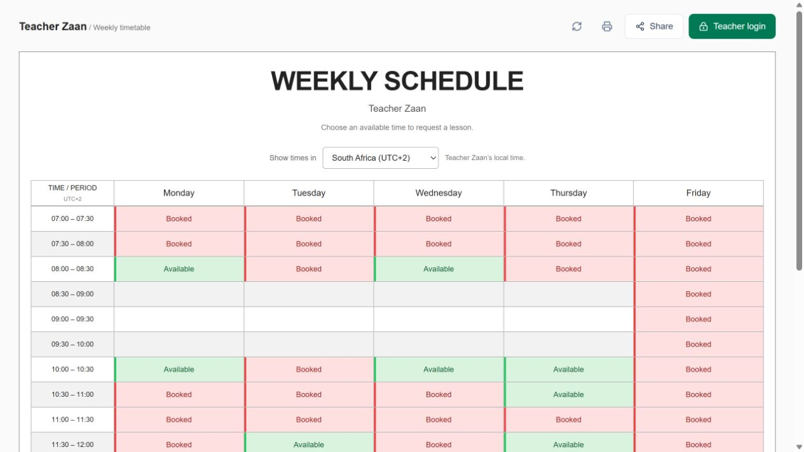

# Teacher Zaan

**A self-hosted teaching timetable, attendance register and billing-period tracker.**

Built for a working language teacher: visitors view availability and request lessons, while the teacher privately manages students, attendance, make-up classes and provider-specific billing counts.

[Live public timetable](https://teacherzaan.com) · [Architecture](docs/ARCHITECTURE.md) · [Case study](docs/CASE_STUDY.md) · [Deployment guide](docs/DEPLOYMENT.md)



## Why this project exists

A weekly plan does not show how many classes were delivered. Missed lessons, reschedules and different company billing periods make a simple slot count unreliable. This application separates the recurring plan from dated records, and attendance from chargeability.

## Features

- **Public timetable:** 100 permanent half-hour slots, South Africa/China time display, lesson requests, sharing and landscape printing.
- **Private teacher workspace:** student/company assignments, daily lessons, reports and timetable editing.
- **Attendance:** automatic completion after lesson end, editable absences/cancellations, notes and history.
- **Billing counts:** calendar-month and 16th–15th periods, completed classes, absences, billable absences and total billable lessons.
- **Rescheduling:** linked replacements on their actual dates, without changing the recurring timetable or counting the original twice.
- **Data protection:** status-only public responses, authenticated admin routes, HttpOnly sessions, same-origin mutations and stale-write detection.

## Stack

TypeScript · Next.js 16 / React 19 · Tailwind CSS · Radix UI · SQLite (`better-sqlite3`) · Node.js · Nginx · systemd · Raspberry Pi · Cloudflare Tunnel

## Run locally

Requires Node.js 22. No hosted database or cloud account is needed.

```sh
npm ci
cp .env.example .env.local
node scripts/configure-admin.mjs
npm run dev
```

Open `http://localhost:3000` or `/admin`. On Windows, replace `cp` with `Copy-Item`. The database starts empty; create named Booked slots and assign companies to begin.

**Production credentials are not included.** Runtime configuration, databases, private operational notes and real student screenshots are excluded from Git. See the [configuration guide](docs/DEPLOYMENT.md).

## Verify

```sh
npm test
npm run typecheck
npm run build
node tests/http-check.mjs
```

Tests use temporary/in-memory databases and fixed clocks. They cover start dates, normalized names, attendance corrections, billing boundaries, rescheduling, persistence, privacy, conflicts, authentication and migration. HTTP integration starts an isolated production server on port 3001. GitHub Actions runs these checks on pushes and pull requests.

## Engineering highlights

| Challenge | Approach |
|---|---|
| Weekly edits must not rewrite history | Effective-dated revisions and dated lesson snapshots |
| Repeated refreshes must not duplicate classes | Unique occurrence keys and transactional reconciliation |
| An absence may still be billable | Independent attendance and billable fields |
| A make-up class crosses a billing boundary | Linked replacement; billing follows its actual new date |
| Visitors must not see student records | Server-side field projection and route authorization |
| Concurrent edits can overwrite newer work | Version tokens and conflict responses |
| Existing databases must survive new features | Transactional migration, WAL and online backups |

Read the [architecture](docs/ARCHITECTURE.md) for the lifecycle and tradeoffs, and the [case study](docs/CASE_STUDY.md) for interview discussion points.

## Current scope

Designed for one teacher and one application instance. Automatic completion is a correctable assumption, not verified attendance. Reports count classes rather than calculate monetary invoices. WhatsApp, payments, multi-tenant accounts and fuzzy identity matching are future work. Historical attendance before installation is not inferred from today's timetable.
