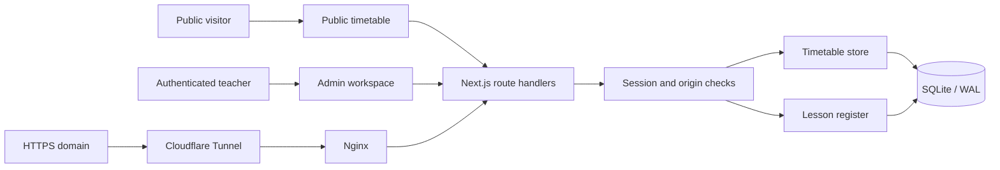
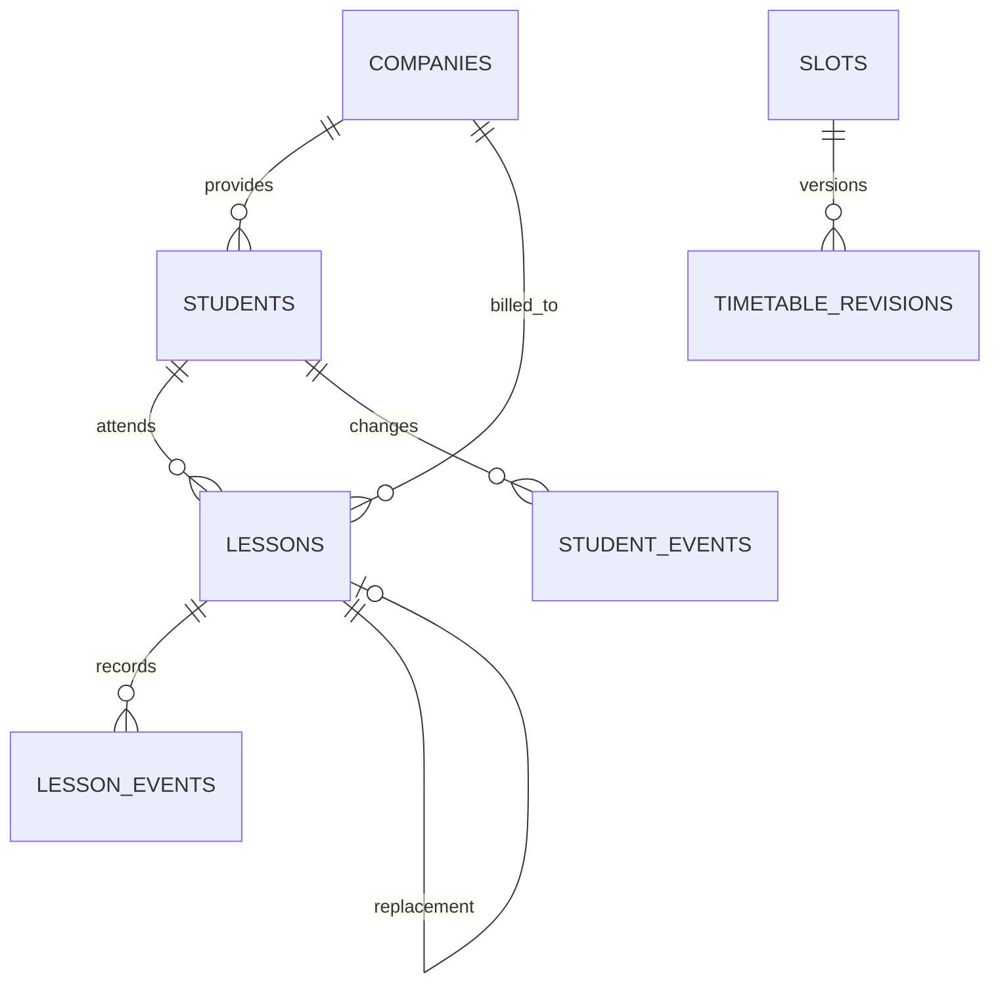

# Architecture

Teacher Zaan separates a permanent weekly timetable from dated lesson records. Editing next week's plan must not rewrite last month's attendance or billing.

## Data model

- **Slots:** 100 recurring half-hour periods, Monday–Friday, 07:00–17:00 South African time.
- **Timetable revisions:** effective-dated snapshots, selected according to when a lesson started.
- **Students:** stable IDs and unique normalized names. Matching trims whitespace, normalizes Unicode and ignores case.
- **Companies:** billing cycle and first tracking date. A student belongs to one company at a time.
- **Lessons:** student/company/date/time snapshots. A unique source key makes recurring generation idempotent. Linked replacements prevent double counting.
- **Events:** before/after attendance, billing and student-company changes.

## Lifecycle

1. An authenticated register read reconciles teaching days through today. Timetable mutations reconcile elapsed lessons before recording the new revision.
2. Named Booked and Catch-up slots generate dated lessons. Unnamed, Empty, Available, Break and Blocked slots do not.
3. Scheduled lessons whose end time has passed become Completed and billable.
4. The teacher can correct attendance and independently choose whether an absence is billable.
5. Rescheduling creates a replacement on the new date, marks the original Rescheduled and removes its billable flag. The recurring template is unchanged.
6. Reports filter the dated records by calendar month or company billing range.

Open register screens refresh every 30 seconds. If the browser is closed, reconciliation catches up from persisted revisions at the next access. This is lazy reconciliation, not an always-running job scheduler.

## Time and billing

South African dates/times (UTC+2) are authoritative. The public timetable can display China time (UTC+8), without changing stored IDs. Billing ranges are inclusive: calendar month, or the 16th through the following month's 15th. Completion and chargeability are separate facts; no monetary invoice is calculated.

## Security and concurrency

Public queries return statuses only and project Blocked as Booked. Names, companies, attendance, reports and history require a teacher session, even when the public browser already has a cookie.

Authentication uses an environment-supplied scrypt hash, opaque session tokens, hashed session storage, HttpOnly cookies, expiry and revocation. Same-origin JSON mutation checks reduce CSRF exposure. Version tokens reject stale slot, student and lesson writes. SQLite WAL, foreign keys, busy timeout and immediate transactions protect concurrent changes.

## Tradeoffs and limits

- SQLite and one application instance suit a single teacher on a small host; multi-tenant scale needs a different operational design.
- Automatic completion is a correctable assumption, not verified physical attendance.
- Normalization is not fuzzy matching. Misspellings need correction; identical names for different students need a future identity workflow.
- The initial snapshot is taken on installation. Earlier attendance is not fabricated from today's template.
- The login/rate limits are intentionally small-scale. MFA, distributed abuse protection and multi-user roles are not implemented.
- WhatsApp, notifications, payments and monetary invoices are outside the current scope.

## Code map

| File | Responsibility |
|---|---|
| `src/components/schedule-app.tsx` | Public schedule, login and timetable editing |
| `src/components/lesson-register.tsx` | Daily register, students, reports and corrections |
| `src/lib/schedule.ts` | Slot types and timezone display |
| `src/lib/store.ts` | Timetable, authentication, requests and migration |
| `src/lib/lesson-store.ts` | Reconciliation, dated lessons, billing and history |
| `src/lib/lessons.ts` | Shared types and date/cycle calculations |
| `src/app/api/[...path]/route.ts` | HTTP authorization, validation and mutation dispatch |

## Verification

Store tests use isolated databases and injected clocks. They cover start dates, boundaries, normalized identity, completion, corrections, billing, rescheduling, persistence, reassignment, conflicts and migration. HTTP integration starts a production server against temporary data and exercises authorization, privacy, CSRF, requests, edits and logout. CI runs both layers, TypeScript and a production build.
